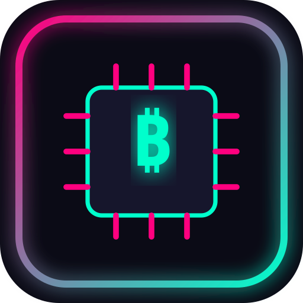

# ⚡ Cyber Economy Tycoon



**Cyber Economy Tycoon**, cyberpunk temalı, web tabanlı modüler bir idle/clicker oyunudur. Oyuncular ByteCoin kasar, sunucu ve yapay zeka yükseltmeleri satın alır ve Firebase entegrasyonu sayesinde hesap oluşturarak ilerlemelerini kaydeder.

---

## 🚀 Özellikler

* 🎮 **Cyberpunk Idle Mekaniği:** Tıklayarak veya otomatik botlarla ByteCoin kazanma.
* 🔐 **Firebase Authentication:** E-Posta/Şifre ve Google ile tek tıkla hızlı giriş (Popup Auth).
* 📱 **PWA Support (Progressive Web App):** Mobil cihazlarda "Ana Ekrana Ekle" özelliği ve çevrimdışı çalışma (Service Worker).
* 💰 **Shopier & Monetization:** Dahili Shopier mağaza yönlendirmesi ve Google AdSense reklam entegrasyonu.
* ⚡ **Modüler Mimari:** Karmaşık derleme araçları (build tools) olmadan saf HTML, CSS (Orbitron Fonts) ve Vanilla JS (ES Modules).

---

## 📂 Dosya Yapısı

```text
cyber-economy-tycoon/
├── index.html        # Ana HTML yapısı ve modal ekranları
├── style.css         # Cyberpunk neon UI stilleri
├── config.js         # Firebase SDK ve konfigürasyonu
├── auth.js           # Giriş, kayıt ve oturum yönetimi
├── game.js           # Oyun döngüsü, tıklama ve yükseltme mantığı
├── manifest.json     # PWA uygulama manifesti
├── sw.js             # Service Worker (Çevrimdışı önbellekleme)
├── icon.svg          # Vektörel cyberpunk uygulama ikonu
├── README.md         # Proje dokümantasyonu
├── LICENSE           # MIT Açık Kaynak Lisansı
└── SECURITY.md       # Güvenlik politikaları
